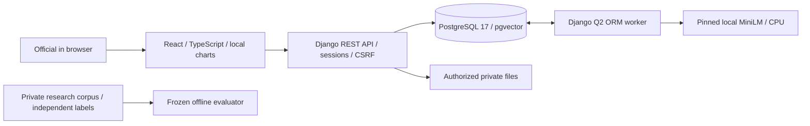
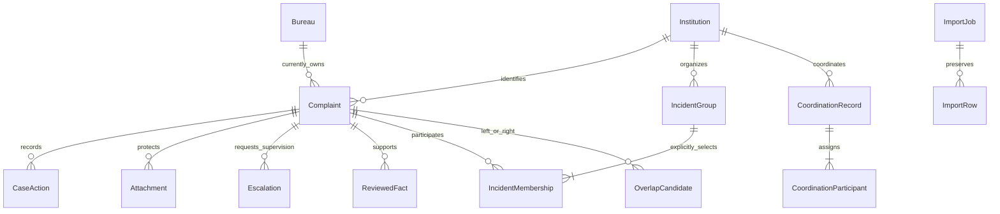

# SIH 26264 — implementation design

This prototype gives an official one institution history across separately owned cases. It supports accountable coordination; it is not a live connection to AICTE systems, an adjudicator or an automatic case-merging service. All demonstration institutions and complaints are fictional. Public research data is kept outside application databases.

## High-level design

Vite's proxy provides same-origin development/preview API access. The prepared frontend is bundled locally. Ordinary startup requires Docker, locked prepared dependencies, existing migrations, private storage and pinned weights. Preparation and startup are separate. The audit deployment uses a different database/private volume and ports 8001/5174; tests reject working-demo ports 8000/5173.

## Database relationships

Canonical Permanent ID is unique and database-protected against changes. Complaints use UUIDs, idempotent submission/source keys and versions. Overlap pairs are ordered and unique. Original allegation corrections append notes. CaseAction and AuditEvent are authoritative append-only application histories; protected parents cannot cascade-delete them. `bureau_at_action` is inserted by PostgreSQL from current ownership, including the transfer destination. Legacy unknown ownership remains NULL. This does not claim protection against an unrestricted database administrator.

Coordination records explicitly select cases at one institution, assign a lead and participating officers, and track acknowledgment/completion independently of case status. A relationship decision is a finding about case relatedness, not an administrative agreement.

## Low-level boundaries

| Source | Responsibility |
|---|---|
| `cases/access.py` | Current active membership, case scope, filters, restricted action filtering |
| `cases/api.py`, `serializers.py` | Registration, actions, version conflicts, detail, dashboard and files |
| `cases/institutions.py` | Registry, audited/versioned editing, all-time overview and paginated cases/history |
| `cases/relationships.py`, `evidence.py` | Deliberate relationship decisions and immutable decision-time snapshots |
| `cases/coordination_workflow.py` | Institution-first locking, agreed work, valid officer assignments, acknowledgment and outcomes |
| `cases/imports.py`, `source_intake.py` | Bounded spreadsheet validation, durable batches, conflicts and source-upload history |
| `cases/matching.py` | Pinned model, exact institution-filtered top-five discovery, preserved human decisions |
| `cases/intelligence.py` | Current deterministic briefs, exact source-span proposals, reviewed facts and explicit groups |
| `cases/shadow.py` | Disabled, management-only experimental semantic/FTS/reference discovery; no runtime suggestions |
| `cases/analytics.py`, `exports.py` | Scope-aware reporting, movements and exports |
| `cases/tasks.py` | Reminder validity and background work |

All writes validate server-side permission, input and expected version where applicable. Institution-first locks serialize conflicting workflows; pair/group/case locks follow within that institution. JSON conflict responses use HTTP 409. Frontend visibility is an aid, never an authorization grant.

## Complaint lifecycle

Register an original allegation with a canonical institution and Bureau. Registration, initial CaseAction and matching task commit together. Receipt plus the demonstration 30-calendar-day policy sets a deadline. The worker produces review candidates and visible complete/failed matching state. Officers record notes, classifications, next actions and authorized status changes. Coordinators may transfer ownership, assign officers, reopen with reasons, review relationships and coordinate cross-Bureau work. Closure requires a resolution note. Transfers and closure preserve independent case history. Escalation requests supervisory attention; it does not transfer a case, advance a next-action date or acknowledge coordination.

Open = status other than `disposed`. Closed is the UI label for `disposed`. Overdue = open and deadline earlier than now. Approaching = open with deadline from now through seven days, excluding overdue. Cross-Bureau notices require active cases currently owned by at least two distinct Bureaus. Dashboard receipt-date cohorts and all-time active coordination are explicitly different. Institution history/overview remain all-time regardless of dashboard date filters. Reports use the same scope/filter definitions as their underlying lists; snapshots are point-in-time aggregates and are never summed across dates or added to case totals.

## Source intake, detection and decisions

Independent Bureau CSV/XLSX files retain genuine source IDs/status/Bureau provenance. Canonical institutions are resolved by Permanent ID, not similar names. Preview validates before durable import. Identical source repeats are duplicates; changed allegations become conflicts for explicit review. No external source automatically overwrites original allegations or workflow status. Import progress/statistical reports precede matching completion. Formulas, invalid formats, excessive content and unauthorized files are rejected.

Rule-based notices detect concurrent current ownership across Bureaus. Semantic matching embeds the original summary only, validates the 256-wordpiece limit and uses normalized 384-dimensional MiniLM vectors at the same institution. The production nearest-five policy and threshold remain frozen. Evidence distinguishes recorded source reference from shared text, unknown incident date, genuine cosine and metadata. Only an official decides same incident, related issue or unrelated, with a reason and decision-time snapshot in both case histories. No arbitrary confidence percentage is generated.

The B2 command compares semantic20, PostgreSQL FTS20 and explicit reference20, with union at most 60. Lexical rank/RRF priority are not cosine or confidence. Missing embeddings remain unscored. It records SQL EXPLAIN ANALYZE/BUFFERS, truncation and sparse-label limitations. Synthetic fixture insertion is rolled back. It cannot activate production expansion; sufficient independent evidence and a separate acceptance decision are required.

## Case intelligence

`GET /api/cases/{id}/brief` reads current authorized records on each request; the collapsed UI polls only while open. It separates original allegations, recorded metadata, current responsibility and human relationships. `GET /api/cases/{id}/history` is server-paginated. Officers receive no cross-Bureau relationship status/counts.

`ENABLE_REVIEWED_FACTS=1` enables exact-span proposals for ISO incident dates, references and requested remedies. Officers propose only for current-Bureau cases; coordinators review, auditors read. Supporting field, Unicode character offsets, quote, SHA-256 digest, original value/method and proposer are immutable. State changes have versions/reasons/reviewer/timestamps and append CaseAction. A correction changes review state with another audit action; it does not overwrite allegations or silently rewrite the complaint's recorded dates. No OCR, cloud model or LLM extraction is used.

`ENABLE_INCIDENT_GROUPS=1` separately enables manual management-only groups. Each selects 2–20 cases from one institution, keeps protected active/inactive memberships and audit snapshots, and uses optimistic versions. A complaint may appear in multiple justified groups. Optional support must be a reviewed same-incident pair among selected members. Support changes flag review without editing membership. Group changes do not change case ownership/status, deadlines, escalation or acknowledgments. Officers cannot see group identifiers, counts, histories or exports. Both controls default off; the normal demo does not advertise experimental features.

## Authentication, files and reporting

Django sessions and CSRF protect login and mutations. Current active membership/ownership is queried for authorization, not cached at login. Scope applies to direct detail URLs, lists, pagination, aggregates, exports, attachments and history. Private local attachments use generated storage names, byte/type/size checks and authorized forced downloads. Reports are deterministic factual summaries from stored records, with CSV and print-to-PDF. Large exports use the existing durable job/streaming path; no generative report model is required.

MCP is intentionally absent: no approved per-user identity, credential revocation or genuine-data third-party handling policy exists. There is no shared administrator adapter or UTCP gateway.

## Operation and recovery

Use `scripts/start.ps1 -Action Prepare` once online, then `-Action Start` for prepared execution, with `-Audit` for the isolated stack. `seed_if_empty` seeds only a completely empty designated demo database; preparation does not append fixtures to an existing installation. Check validates Node, Docker, checksums and prerequisites; failures propagate. Shutdown stops only recorded workspace-owned Vite processes and selected Compose services, retaining volumes. Secrets belong in ignored `.env`, with `.env.example` as the template; initialized database credentials live in the volume and are not reset by editing the environment file.

Back up PostgreSQL and private files together and retain model manifests/licence. `scripts/verify_final_restore.py` restores the current audit schema, file archive and pinned model into new destinations, compares every case-table rowset and exercises restored reads/downloads/inference. The working database is not accessed by that verifier. `verify_import_recovery.py` checks a real worker stop/start with queued synthetic rows. A physical offline cold start requires the operator to disconnect Wi-Fi/Ethernet and run `verify-physical-offline.ps1`; blocked web requests alone are insufficient proof.

## Five-minute fictional demonstration

1. **0:00–0:45:** sign in as coordinator; import the prepared independent RB/PGRC Bureau fixtures from `tests/fixtures/bureau-intake` into canonical `SIH-26264-DEMO`. Explain original source references and conflict handling.
2. **0:45–1:30:** search the institution, open its all-time overview, complete case list and history; follow the cross-Bureau notice to currently responsible Bureaus.
3. **1:30–2:20:** compare the two refund allegations, inspect evidence and genuine cosine, distinguish an unrelated laboratory complaint, deliberately record a relationship/reason.
4. **2:20–3:20:** create an agreed coordination record with existing authorized officers and action dates; show officer acknowledgment in a separate login and return to coordinator follow-up.
5. **3:20–4:15:** record a next action or transfer with reason; show destination ownership and historical Bureau snapshot. Open the current case brief. Keep case deadline, next action, escalation and coordination state distinct.
6. **4:15–5:00:** show updated scoped dashboard, drill down to equivalent cases, and export the report. Mention synthetic evaluation, human decisions and outstanding real-data/offline limitations.

If the model is unavailable, show the explicit failed/pending matching state and manually review a pair using recorded evidence; do not pretend inference succeeded. If the worker is delayed, show queue coverage and use already processed fictional cases. If disconnected after preparation, use local assets/database; source imports are local files, not live integrations. If startup fails, use saved screenshots and explain the failure rather than claim a live working flow.

Fresh regression, restore and performance evidence is consolidated in `tests/results/SIH_26264_FINAL_TECHNICAL_READINESS_REPORT.md`; historical reports remain distinct. Graphify is developer navigation only; source and tests govern behavior.
