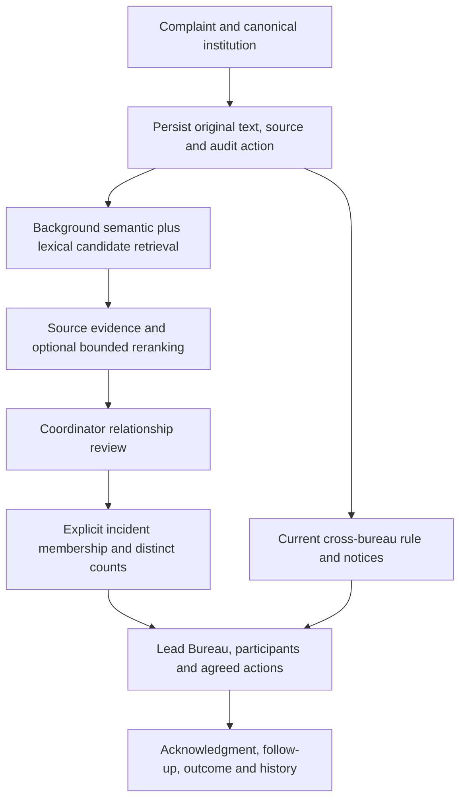

# SIH 26264 — core complaint intelligence and coordination plan

Research and source audit: 2 November 2026, Asia/Calcutta. Local and remote main verified at `f73fc0e0bcb33ef1a5f0342bf9c817dca3ce6097`. This is a planning artifact, not an implemented feature or a model promotion.

## 1. Product decision

Build around this official's journey: **find an institution → inspect every authorized case → see concurrent Bureau activity → compare related allegations → record the relationship → agree responsibilities → monitor completion**.

Similarity assists the review. A count of similar wording does not establish duplicate incidents, and a count alone does not prevent parallel official actions. Preserve independent complaints, deadlines, source references, decisions and histories.

No model replacement or additional training is justified yet. First implement trustworthy counts and evaluate the existing retrieval against independently reviewed education incidents. Reuse the institution registry, current matching, shadow retrieval, reviewed relationships, experimental incident groups and coordination workflow.

## 2. Specification basis and limitations

The supplied `ChatGPT-Problem Statement Comparison-20261029-2115.md`, line 26, contains the working SIH26264 specification. The official [2026 statement page](https://www.sih.gov.in/sih2026PS) returned HTTP 403 during this research. A public mirror agrees on the title, but it is not an authoritative replacement. Verify official wording with the organizer before claiming compliance. No submission dates or competition statistics from mirrors are used here.

The supplied statement permits data matching, rules and/or AI-assisted analytics. It does not require BERT fine-tuning. Its example concerns the same institution being handled by RB and PGRC, even when references/descriptions differ. That is broader than duplicate-text detection.

| Statement requirement | Current source evidence | Action for this cycle |
|---|---|---|
| Canonical institution identity and consolidated history | Institution registry/profile, immutable Permanent ID, scoped paginated cases/actions | Reuse; test unknown IDs and imports from independent sources |
| Present Bureau/officer, status, last/next action and deadline | Complaint workflow, classification, next action, transfers and optimistic versions | Reuse; exercise the full official journey |
| Identify multiple Bureaus handling one institution | `coordination.py`: at least two distinct current Bureaus with open cases | Preserve separately from semantic matching; reconcile notice counts |
| Link related cases and avoid duplicated action | Reviewed pair relationships plus agreed coordination participants, acknowledgments and outcomes | Connect group views to this existing workflow; never infer acknowledgment from a score |
| Recognize different wording about related complaints | `matching.py`: summary embeddings, exact institution-filtered cosine retrieval | Evaluate; expand retrieval only through a measured shadow comparison |
| Report duplicate/overlap workload meaningfully | Pair/notice counts exist; experimental manual groups exist | Add distinct-case and reviewed-incident counts with explicit definitions |
| Pending/closed/under-process/transferred/escalated monitoring | Dashboard, movements, escalation and Reports code | Preserve `disposed` in storage, Closed in UI; transferred is an action, not a fifth case status |
| Alerts and prescribed timelines | Notification/reminder/escalation logic | Preserve; confirm actual AICTE policy before changing the labelled demo deadline |
| Institution/region/Bureau/status/date reports and monthly/quarterly analytics | Shared filters, Reports, movement CSV and scoped exports | Add reviewed-group/suggestion metrics; keep scopes and denominators visible |
| Authorized use and accountable history | Current membership/ownership scope, protected files, append-only case actions | Apply identical authorization to new counts, group membership, exports and caches |

This table is a source audit supported by prior verification, not a fresh execution of every backend workflow in this research turn. The preceding UI release passed 77 Edge tests; those tests do not establish semantic accuracy.

## 3. What the application actually recognizes today

The [current GitHub matcher](https://github.com/SanjaiS12a/SIH-AICTE/blob/main/backend/cases/matching.py) was fetched and checked against the local source.

1. A complaint is assigned a canonical institution explicitly.
2. The local MiniLM sentence encoder embeds its allegation **summary**. The full description is stored but is not encoded by the production matcher. Category/classification are recorded fields, not automatically established findings.
3. It compares with cases at the same institution using the same model revision, including Closed cases.
4. It takes the nearest five, then applies the frozen cosine cutoff `0.603080153465271`.
5. Passing ordered pairs become review suggestions. Existing reviewed decisions survive reruns.
6. An officer/coordinator's authorized workflow records actions; a coordinator reviews relationships as same incident, related issue or unrelated.

The model represents textual meaning sufficiently to propose paraphrases. It does not verify the allegation, identify the complainant/event conclusively, read attachments, or decide a remedy. Missing facts cannot be recovered reliably by changing an embedding model.

Current limitations:

- Five neighbors are the per-match retrieval cap, **not the total number of similar complaints or an API pagination limit**. A case may accumulate additional stored pairs when later submissions are processed. Earlier submissions can lack candidates that were not yet embedded; complete corpus coverage needs explicit handling.
- Pair count is not complaint count: three complaints can produce three pairs; four can produce six.
- Related concerns may involve different students, academic years or remedies. They can deserve coordination without being one incident.
- The same-institution coordination rule already works without semantic similarity. It must continue to detect concurrent work when the wording is completely different.
- `shadow.py` already combines lexical, semantic and reference channels experimentally. It is not called by production matching; preserve that separation while evaluating it.
- `intelligence.py` already supports source-span facts and manual incident membership. Both experimental feature flags are currently disabled by default. Its group response lists members; it is not yet a complete production distinct-incident analytics contract.

## 4. Counts and labels to implement

Use the following definitions before changing a model or adding charts.

| Display | Definition | Interpretation |
|---|---|---|
| Received complaints | Distinct canonical complaint IDs in the selected receipt cohort | Re-uploading the same source record adds zero new complaints |
| Potential related cases for this complaint | Distinct other case IDs passing a specified retrieval policy, within a declared institution/corpus/version scope | Model/rule suggestions; never a confirmed duplicate count |
| Cases with queued overlap reviews | Distinct union of endpoints of pending stored suggestion pairs | Counts current queue contents; does not claim exhaustive discovery |
| Confirmed incident group | Explicit coordinator-reviewed membership supported by recorded reasons/evidence | A reviewed operational grouping; complaints remain separate |
| Cases in this incident | Distinct active member case IDs in that reviewed group | Can include open and Closed cases, labelled separately |
| Institutions needing coordination | Institutions with at least one open case in each of two or more distinct current Bureaus | All-time current ownership; not dependent on a cosine threshold |
| Outstanding coordination records | Distinct open coordination record IDs with a required missing acknowledgment | All-time workflow count, separate from receipt-filtered complaint counts |

For a case detail page, offer a server-paginated related-case list and, when feasible, an exact above-threshold count across all eligible institution embeddings. Run that count without the top-five limit. Record the model/policy version, eligible corpus size, missing/failed embeddings and refresh time. If work is partial, say so; zero processed matches is different from a fully evaluated zero.

For larger institutions, run expensive coverage/count jobs asynchronously. A bounded approximate candidate search must say **found/estimated/lower bound**, not claim an exhaustive total. Never launch institution-wide all-pairs comparison merely to produce a homepage counter.

Confirmed group counts come from explicit membership, independently of top-k retrieval. A complaint covering multiple incidents may appear in more than one group; group totals therefore must not be summed as an institution's unique complaint total. Count the union of complaint IDs for that total. Groups flagged `needs_review` must be visibly provisional and excluded from any unqualified confirmed total.

**Illustration, not measured project data:** six complaints refer to one blocked refund event; two concern refunds in a different academic year; one concerns laboratory safety. Display nine complaint records, two reviewed refund incidents if established, and their individual member counts. Do not call all eight refund complaints duplicate submissions. Whether the lab case warrants Bureau coordination is a separate current-ownership rule.

Do not build groups by transitive closure: A similar to B and B similar to C does not prove A and C concern the same event. Related-issue links must not automatically become same-incident membership.

## 5. Research findings and their project implications

The sources below cover primary papers, a journal abstract, official research blogs, official model/documentation pages and public GitHub implementations. This is a targeted literature review, not a claim to have examined every study/platform.

| Evidence | What it supports | Project decision |
|---|---|---|
| [Sentence-BERT, EMNLP-IJCNLP 2019](https://aclanthology.org/D19-1410/) | Efficient reusable sentence vectors | Keep a compact encoder for candidate search; do not apply a pairwise BERT to every corpus pair |
| [MiniLM model card](https://huggingface.co/sentence-transformers/all-MiniLM-L6-v2) | 384-dimensional short-text encoding; default 256-wordpiece truncation | Keep summary validation; evaluate source-preserving paragraph retrieval for long descriptions |
| [PAWS, NAACL 2019](https://aclanthology.org/N19-1131/) and [Google Research explanation](https://research.google/blog/releasing-paws-and-paws-x-two-new-datasets-to-improve-natural-language-understanding-models/) | High lexical overlap can hide different meanings | Test reversals, negation, changed year/reference/remedy; generic paraphrases do not establish common incidents |
| [BEIR, NeurIPS 2021](https://arxiv.org/abs/2104.08663) and [authors' repository](https://github.com/beir-cellar/beir) | Retrieval performance varies across domains and methods | Compare lexical and dense retrieval on this domain rather than trust a general leaderboard |
| [Duplicate Bug Report detection using Named Entity Recognition, Knowledge-Based Systems](https://www.sciencedirect.com/science/article/abs/pii/S0950705123010079) | Available publisher-indexed abstract motivates structured information alongside descriptions | Evaluate references/dates/remedies as evidence; bug-report findings are not grievance accuracy. Full publisher page returned 403; no full-paper claim |
| [Sentence Transformers retrieve/rerank guidance](https://www.sbert.net/examples/sentence_transformer/applications/retrieve_rerank/README.html) | Fast retrieval followed by more expensive pair ranking | Test a small reranker on a bounded candidate set, not on all complaint pairs |
| [Official paraphrase mining](https://www.sbert.net/examples/sentence_transformer/applications/paraphrase-mining/README.html) and [clustering examples](https://www.sbert.net/examples/sentence_transformer/applications/clustering/README.html) | Practical mining/clustering with caps and trade-offs | Use suggestions for exploration; do not interpret returned top-k lists as exhaustive incident groups |
| [Official training overview](https://www.sbert.net/docs/sentence_transformer/training_overview.html) and [loss overview](https://www.sbert.net/docs/sentence_transformer/loss_overview.html) | The desired notion of similarity and label format determine training | Separate review-worthy retrieval from same-incident classification; choose loss after label audit |
| [Sentence Transformers repository](https://github.com/huggingface/sentence-transformers) | Maintained embedding/reranking implementation | Reuse the already installed library rather than introduce a second ML stack |
| [pgvector repository](https://github.com/pgvector/pgvector) | Exact filtered search and approximate search with recall/filter trade-offs | Keep exact institution filtering first; benchmark HNSW against exact results before adoption |
| [IIT Kanpur IGMS account](https://iitk.ac.in/intelligent-grievance-monitoring-system-igms) | AI-assisted grievance analysis has a government deployment precedent | Demonstrate accountable Bureau coordination as the product benefit, without claiming IGMS accuracy transfers here |
| [DARPG public grievance guidelines](https://www.darpg.gov.in/sites/default/files/Comprehensive_guidelines_for_handling_the_Public_Grievances.pdf) | Integrated handling and responsible grievance workflows | Use as related operational context, not authority to impose an unverified AICTE SLA |

## 6. Recommended pipeline

Implementation choices:

1. **Evidence first:** use source reference/system, allegation category, explicitly recorded incident date, course/batch/year where available, requested remedy and negation. Distinguish unknown from different. Shared reference text across different source systems is not source identity. A different year/date is a review cue, not an unconditional rejection.
2. **Hybrid candidates:** compare existing semantic top-five against the existing shadow union. Initially bound each channel to 20 candidates, deduplicate by complaint ID, then rank the union. Preserve source provenance. PostgreSQL full-text ranking is already present; it is not BM25 and must not be labelled BM25.
3. **Long complaints:** test paragraph/issue-level representations from the immutable description with exact source offsets, tokenizer-aware chunks and passage-to-case deduplication. Keep summaries as a baseline. Calibrate the new scoring policy separately: more passages/max-score pooling can increase false positives. If paragraphs are unavailable or text is unsupported, show the limitation. Do not silently truncate or invent a summary.
4. **Optional reranking:** only if candidate recall is adequate but ranking precision is poor. The [MS MARCO MiniLM cross-encoder](https://huggingface.co/cross-encoder/ms-marco-MiniLM-L6-v2) is trained for query/passage relevance, not incident identity. Treat it as an experimental ranker, never a duplicate-probability oracle.
5. **Explicit grouping:** reuse `IncidentGroup`/`IncidentMembership`, with coordinator review, version checks, retirement/correction history and visible provisional states. Pilot the existing feature under management-only access before production activation. No automatic case merging or disposal.
6. **Operational action:** a reviewed relationship/group can lead into the existing coordination record. Assign responsibility, seek acknowledgments and monitor follow-up. Similarity, next-action dates, case deadlines and escalation remain distinct.

All restricted suggestions, counts, references and memberships remain coordinator/auditor-only. Officers retain current-Bureau access and explicitly addressed coordination instructions. New summary APIs and caches must calculate permission scope before aggregation; frontend hiding is insufficient.

## 7. Fine-tuning and model replacement decision

The project's own [fresh model comparison](fresh-model-comparison.md) already answers whether more generic training necessarily helps:

- A one-epoch PAWS candidate was trained on **79,656 pairs**. It is experimental, not the active application model.
- On 1,725 fresh MRPC news pairs, original/candidate ROC-AUC were **0.7363 / 0.6624**.
- On 36 authored education diagnostic pairs, original/candidate F1 were **58.82% / 28.57%**, using their previously frozen diagnostic operating thresholds.
- Both models incorrectly accepted all twelve changed-reference/year hard negatives under that diagnostic definition. These cases can still be review-worthy related issues.

Those figures are not production matching accuracy, not a new calibration, and not independently reviewed AICTE incident results. They support retaining the baseline rather than promoting this particular candidate.

The safer B1 audit also matters: 162 suggestions were produced for 60 eligible synthetic queries, but only 54 suggestions had judgments. **Overall suggestion precision is unavailable.** Same-incident Recall@5 was 0.90 on those authored families, not verified real-world recall. Do not reuse older headline metrics as proof of real-data accuracy.

| Observed failure after independent evaluation | Next action |
|---|---|
| Same institution not recognized | Fix institution resolution/import mapping; encoder training will not repair canonical IDs |
| Relevant evidence is only deep in the description | Improve source-preserving long-text retrieval |
| Exact IDs/terms are missed | Add/evaluate lexical/reference retrieval |
| Correct case is retrieved but ranked poorly | Test bounded reranking |
| Similar words but different incident details cause confusion | Improve evidence/review rules; consider a supervised relationship classifier if labels support it |
| Reliable domain labels exist and the encoder still misses paraphrases | Fine-tune a compact encoder and compare against unchanged baseline |
| A compact alternative wins on held-out data and laptop cost | Stage a model replacement with backfill, calibration and rollback |
| Source evidence does not identify the incident | Return insufficient evidence; a larger model cannot establish missing facts |

One bounded alternative is [BGE-small-en-v1.5](https://huggingface.co/BAAI/bge-small-en-v1.5): its publisher documents 384 dimensions and a 512-token context. It is a benchmark candidate, not a demonstrated improvement here. Equal vector dimensions do not make models interchangeable; rebuild embeddings separately and use a separately calibrated threshold.

If training becomes justified, use two distinct objectives: retrieve review-worthy pairs (`same_incident` or `related_issue`), and optionally classify relationship identity (`same_incident`, `related_issue`, `unrelated`) on independently reviewed examples. Keep `insufficient_evidence` as an abstention/review state, not an arbitrary negative. Do not use a news paraphrase label as an incident label. Avoid losses that implicitly treat related complaints as negatives without checking that assumption.

Pilot on the existing 4 GB GPU with measured VRAM and throughput, short runs, bounded inputs and early checkpoint selection on validation only. Prior training feasibility is not a promise for a new encoder/reranker or longer text. Export the winning model directory, tokenizer, licence, checksums, preprocessing policy, calibration, evaluation and environment lock for teammates; a weights file alone is insufficient.

## 8. Data and evaluation plan

**First target: 500–1,000 independently reviewed education pairs across at least 150 incident families**, plus a separate query/reference retrieval corpus. These are planning targets, not a claim such data is already available. Grow toward 2,000–5,000 diverse reviewed pairs if learning curves justify it. Fifty thousand to one lakh rows can help later, but only with appropriate rights, diversity and labels; row count is not the objective.

| Source | Permitted/planned purpose | Boundary |
|---|---|---|
| Authorized de-identified AICTE or consenting institutional case exports | Primary domain evaluation and, where permitted, training | Obtain actual rights, institution IDs and event evidence; keep private |
| [DARPG dataset documentation](https://event.data.gov.in/challenge/darpg-challenge/) | Public aggregate report tests; authorized grievance access opportunity | Documentation marks grievance details/movements restricted; old challenge access is not current permission |
| [Mendeley citizen complaint tweets](https://data.mendeley.com/datasets/w2cp7h53s5/1) | Optional grievance-language transfer experiment after audit | Page lists CC BY 4.0; complaint/unknown labels are not relationship labels. Contains personal/social data requiring careful minimization and review |
| [CFPB complaint database](https://www.consumerfinance.gov/data-research/consumer-complaints/) | Optional out-of-domain narrative transfer test | Earlier local collection failed with HTTP 403; do not claim it succeeded from reading the landing page |
| Existing 500 NYC311 structured records | Pipeline/coverage test only | Not education narratives; 28 suggestions and zero adjudicated labels in the existing report, so no accuracy estimate |
| OIA summaries | Education transfer evaluation only if permission later establishes reuse | User explicitly kept collection pending; preserve that decision |
| PAWS/MRPC | Auxiliary paraphrase stress tests | Keep separate from education incident scoring and published partitions |
| Synthetic education scenarios | Deterministic regression, throughput, demonstrator and hard-negative tests | Label provenance explicitly synthetic; no real-world accuracy claim |

No verified open AICTE complaint-text corpus was established by this search. Do not scrape logged-in portals or pool unrelated internet text merely to hit a size target.

Audit every collection for URL/version/checksum, licence/access terms, fields, language, missingness, source duplicates, identifiers, allowed redistribution and label meaning. Keep raw data/private reviewer artifacts outside Git. Public aggregate sheets support dashboards, not training of incident identity.

Two reviewers label independently without seeing scores; adjudicate disagreement. Preserve reasons and source evidence. Include paraphrases, exact repeats, related-but-distinct complaints, different students/years/remedies, contradictory statements, missing dates, multiple issues, same institution/different categories, different institution/similar wording, and long descriptions with crucial details after the summary.

Group all paraphrases, near-duplicate templates and shared incident families before splitting approximately 60/15/10/15 into train/validation/calibration/test. Use institution/time-held-out slices where data permits and report them separately. Prevent template leakage across partitions. No-model-change experiments can use a fixed calibration/test design; once candidate choices are tuned on a test, that test becomes development evidence and a fresh final test is needed.

Retrieval recall requires independently known relevant reference cases, including ones the algorithm misses. Annotating only returned top-five pairs cannot measure recall. Report judgment coverage and uncertainty. Keep synthetic, public out-of-domain and real education results separate.

## 9. Smallest implementation sequence and gates

| Step | Scope and existing files to reuse | Gate |
|---|---|---|
| A — Metric contract and baseline | `matching.py`, `evidence.py`, `api.py`, current B1/public evaluators and fixtures | Freeze definitions, inputs/model/policy; reproduce examples with distinct case/pair/group counts |
| B — Related counts and explicit groups | Extend `api.py`/`intelligence.py` and existing models; additive migration only if needed; `intelligence.tsx`, institution profile and Reports | Nine-case illustration reconciles; server pagination finds more than five; pending/failed coverage visible; no unauthorized counts; stale edits 409 |
| C — Domain evidence | Extend existing annotation/source register/research scripts | Independent domain labels, source permissions and family-safe split ready; otherwise keep real accuracy unknown |
| D — Retrieval comparison | Reuse `shadow.py`; compare semantic, lexical, union, then optional paragraph retrieval | Candidate recall/precision/cost compared on frozen inputs; no production activation merely because suggestions increase |
| E — Optional model experiment | Existing training/evaluation scripts, `StagedEmbedding` and `ModelRelease`; at most one encoder alternative and one bounded reranker initially | Validation selects candidate; calibration freezes cutoff; held-out test evaluated once; baseline retained on failure |
| F — Coordination and reporting completion | Existing `coordination_workflow.py`, notifications, institution pages and Reports | Reviewed incident leads to assigned action/acknowledgment/outcome; histories/CSV/counts reconcile after transfer, closure, correction and replay |
| G — Release evidence | Isolated Django/Edge suites, backup/restore, benchmark and startup scripts | Security/concurrency tests, laptop measurements and operator-assisted physical-offline check recorded; ordinary push only for a reviewed deliverable |

Do A and B first; begin permission/annotation work alongside them. Their completion does not depend on new model training. Do not rewrite React/Django/PostgreSQL, duplicate existing history tables, add a vector service, or introduce an LLM/MCP gateway.

## 10. Acceptance evidence

Deterministic checks: source replay adds no duplicate records; three complaints are not counted as six directed pairs; group correction retains history; A–B/B–C does not auto-group A–C; all-time profiles survive dashboard date filters; current-Bureau notices change correctly after transfer; a multi-incident case is deduplicated in institution totals; restricted counts/files/exports remain inaccessible; pending work never looks like a confirmed zero.

Model objectives, not promises: review-worthy suggestion precision at least 85% and same-incident Recall@5 at least 90% on independently judged held-out education data, with sample counts, category breakdowns, no-reference/no-suggestion rates, coverage and uncertainty. For incident grouping report pairwise precision/recall plus false merges/splits on independently established families; use an explicitly defined overlap-aware measure when complaints belong to multiple incidents. Deterministic member counts alone do not prove grouping accuracy.

Operational evidence: time to register and retrieve, time to review/coordinate, acknowledgment completion and independently measured duplicated/conflicting-action prevention where a genuine baseline exists. A human click or a synthetic demo is not evidence of real-world efficiency gains.

Performance: repeat the 1,000/10,000-row workloads with ten independent users, distributed and concentrated institution sizes, realistic text lengths, queue delay, paragraph/reranker costs and actual RAM/VRAM. Preserve the prior objectives (p95 ordinary reads/registration below 500 ms, dashboard below one second, warm 1,000-row completion within two minutes) as targets requiring new measurement after pipeline changes. Exact counts, expanded candidates and longer text can increase cost. No million-record claim from laptop tests.

Five-minute demonstration: import independent RB/PGRC source records → search institution → show the cross-Bureau notice even for unrelated wording → register a paraphrase → compare with a changed-year hard negative → record a justified relationship and explicit incident membership → show distinct complaint counts → agree Bureau responsibilities → acknowledge/complete action → inspect histories and reconciled report. Use documented synthetic fixtures until authorized real data is available.

## 11. Immediate deliverable and stop conditions

The next implemented deliverable should be **accurate, role-safe related-case counts and reviewed incident groups integrated with the existing coordination workflow**, accompanied by the frozen evaluation examples. It should not be another visual redesign or an unqualified fine-tuning run.

Keep the original MiniLM active unless a separately evaluated candidate improves the relevant domain metrics within measured laptop limits. Keep permissions/data annotation and physical-offline validation explicitly open where evidence is absent. No new application code, migrations, training, model activation or database writes were performed for this research plan.
